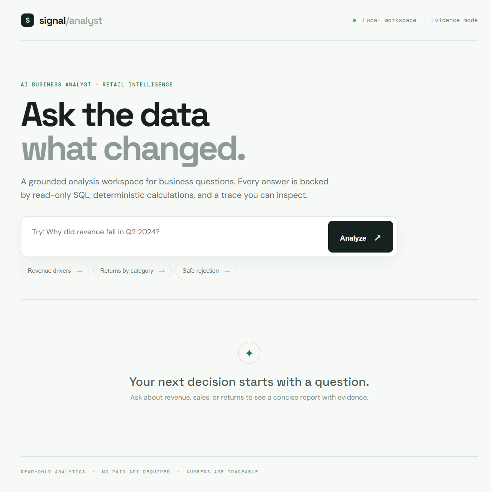
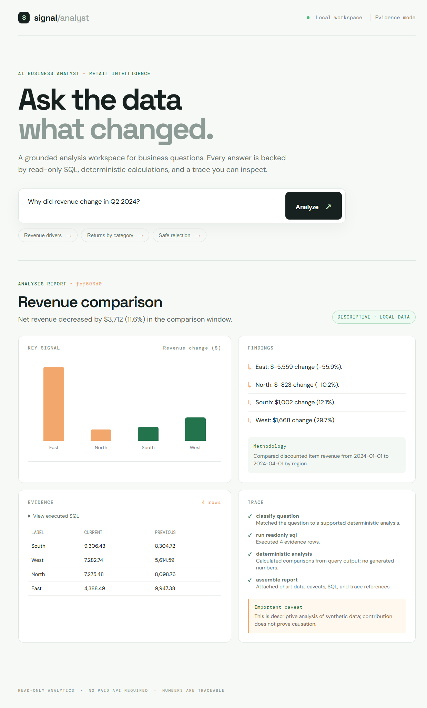

# Signal / Business Analyst

> Ask a business question in plain English. Get a clear answer backed by SQL, calculations, a chart, and an evidence trace.

Signal is a local AI Business Analyst MVP for synthetic retail data. It helps a manager or analyst understand revenue and returns without giving a model unrestricted database, Python, shell, or filesystem access.

## What this project does

You type a question such as:

> **Why did revenue change in Q2 2024?**

The application then:

1. Recognizes the supported business question.
2. Runs a safe, read-only SQL query.
3. Calculates the comparison deterministically.
4. Creates chart data from the query result.
5. Shows the answer, SQL, evidence rows, methodology, caveats, and trace.

The current MVP supports:

- revenue or sales comparisons by region
- return-rate analysis by product category
- safe rejection of unsupported questions
- local SQLite data with no paid API key
- an MCP adapter for the guarded database tools

## Screenshots

### 1. Ask a question

The home screen gives the user a few example questions. The suggestions are useful for a first-time user, but the input also accepts a normal business question.



### 2. Read the result

The report explains the main change, shows the visual signal, lists the regional findings, and explains how the numbers were calculated.



### 3. Verify the evidence

Every report includes:

- the SQL that actually ran
- the returned rows
- a result count
- a trace ID
- the analysis steps
- a caveat explaining that descriptive data does not prove causation

This makes the result inspectable instead of presenting an unexplained AI answer.

## Quick start on Windows

### 1. Create a virtual environment

Open PowerShell in this project folder:

```powershell
py -3.12 -m venv .venv
.\.venv\Scripts\Activate.ps1
```

### 2. Install the packages

```powershell
python -m pip install -r requirements.txt
```

### 3. Start the application

The database is created automatically the first time the app starts. You can also seed it manually:

```powershell
python -m app.seed
python -m uvicorn app.main:app --reload
```

Open **http://127.0.0.1:8000** in your browser.

### 4. Run all tests

```powershell
python -m pytest -q
```

## Example questions

```text
Why did revenue change in Q2 2024?
Which categories have the highest return rate?
Show me our employee data
```

The first two produce reports. The last question is rejected because employee data is not part of the approved dataset. The app explains what it can analyze instead of inventing an answer.

## Simple architecture

```text
Browser
  ↓
FastAPI API
  ↓
Bounded workflow
  ├─ SQL guard → SQLite retail database
  ├─ Deterministic analysis
  └─ Evidence-backed report
```

Important files:

| File | Purpose |
| --- | --- |
| `app/main.py` | FastAPI routes and application startup |
| `app/workflow.py` | Supported-question workflow and report assembly |
| `app/sql_guard.py` | Read-only SQL validation and row limits |
| `app/analysis.py` | Deterministic percentage and comparison calculations |
| `app/seed.py` | Synthetic retail dataset generator |
| `app/static/` | Browser interface |
| `mcp_servers/server.py` | Optional MCP adapter for approved tools |
| `tests/` | SQL, analysis, workflow, API, and security tests |

## Safety and privacy

This repository is designed to be public:

- no API keys are required
- no credentials are included
- the SQLite database is generated locally and ignored by Git
- only synthetic data is used
- SQL is restricted to a single approved `SELECT`
- writes, DDL, comments, multiple statements, unknown tables, and oversized results are rejected
- arbitrary Python and shell execution are not exposed to the workflow

### Environment files

Do **not** create or commit a real `.env` file containing secrets. `.gitignore` excludes `.env`, while `.env.example` contains only a harmless local database-path example. If you later add credentials, keep them only in your local `.env`.

## MCP adapter

The adapter is optional. The core web app does not require the MCP package. When an MCP-compatible client is available, `mcp_servers/server.py` exposes the same guarded contracts:

- `inspect_schema`
- `run_readonly_sql_tool`

Install the official MCP SDK separately if you want to connect an MCP client:

```powershell
python -m pip install mcp
python -m mcp_servers.server
```

## Test status

The project includes automated tests for:

- API response shape and validation
- clean startup database creation
- supported and unsupported workflow questions
- percentage and return-rate calculations
- SQL write/multi-statement/table/row-limit rejection
- Python compilation of the source tree

Run:

```powershell
python -m pytest -q
```

## Public GitHub checklist

Before publishing:

```powershell
git status --short
git check-ignore .env data/retail.db
git diff --check
```

Expected behavior:

- `.env` is ignored
- `data/retail.db` is ignored
- no secret values are committed
- README images are stored in `docs/screenshots/`

The project is local-first and uses synthetic data. Results are descriptive, not proof of business causation.
